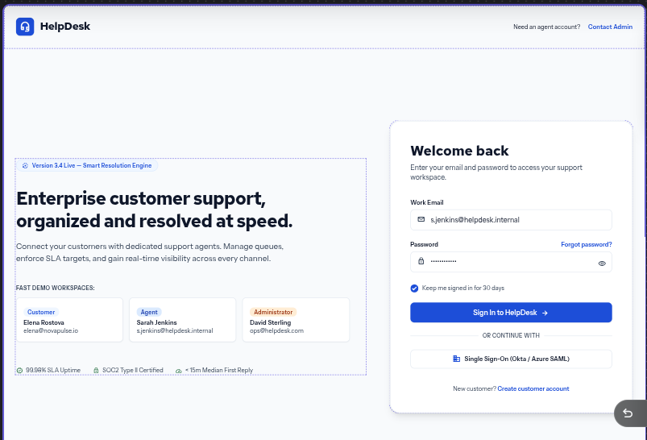
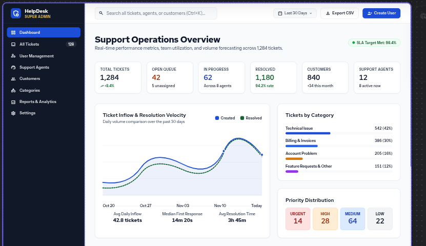
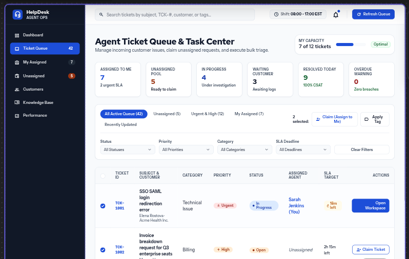
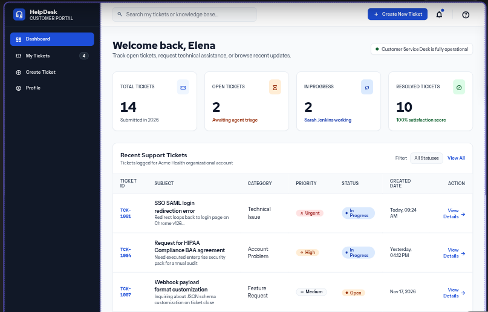

# HelpDesk – Ticketing System

A modern full-stack HelpDesk application that allows customers to create and track support tickets, support agents to manage and resolve tickets, and administrators to manage the entire support system.

## Screenshots

### Login Page


### Admin Dashboard


### Support Agent Dashboard


### Customer Dashboard


## User Roles

The application has three main user roles:

- **Customer:** Creates support tickets, tracks their status, and communicates with support agents.
- **Support Agent:** Manages assigned tickets, responds to customers, and resolves support requests.
- **Administrator:** Manages users, support agents, ticket assignments, categories, and system statistics.

## Features

- User registration and authentication.
- Role-based access control (RBAC).
- Ticket creation and management.
- Ticket assignment and reassignment.
- Ticket status and priority management.
- Customer and agent conversations.
- Customer, Agent, and Admin dashboards.
- User and category management.
- Ticket statistics and reporting.

## Technology Stack

### Backend
- Python
- FastAPI
- PostgreSQL
- SQLAlchemy
- Alembic
- Pydantic
- JWT Authentication

### Frontend
- React
- TypeScript
- Vite
- Tailwind CSS
- React Router
- Axios

### Infrastructure
- Docker
- Docker Compose
- Git

## Project Structure

```text
helpdesk/
├── backend/
│   ├── app/
│   ├── tests/
│   ├── alembic/
│   ├── pyproject.toml
│   └── .env.example
│
├── frontend/
│   ├── src/
│   ├── public/
│   └── package.json
│
├── images/
│   ├── login.png
│   ├── admin.png
│   ├── agents.png
│   └── customer.png
│
├── docker-compose.yml
├── .gitignore
└── README.md
```

## Getting Started

### Prerequisites

- Python 3.12+
- Node.js and npm
- PostgreSQL
- uv
- Docker and Docker Compose (optional)

### Installation

Clone the repository:

```bash
git clone https://github.com/YOUR_USERNAME/helpdesk.git
cd helpdesk
```

### Backend Setup

```bash
cd backend

# Install dependencies
uv sync

# Configure environment variables
cp .env.example .env

# Run database migrations
uv run alembic upgrade head

# Start FastAPI
uv run uvicorn app.main:app --reload
```

Backend API:

```text
http://localhost:8000
```

API Documentation:

```text
http://localhost:8000/docs
```

### Frontend Setup

Open another terminal:

```bash
cd frontend

# Install dependencies
npm install

# Start development server
npm run dev
```

Frontend:

```text
http://localhost:5173
```

## Ticket Status

- Open
- In Progress
- Waiting for Customer
- Resolved
- Closed

## Ticket Priority

- Low
- Medium
- High
- Urgent

## Ticket Assignment

- Administrators can assign tickets to any support agent.
- Support agents can claim unassigned tickets using the **Assign to Me** action.
- Support agents cannot reassign tickets belonging to other agents.

## Security

- Password hashing.
- JWT-based authentication.
- Role-based access control.
- Backend permission validation.
- Environment variables for sensitive configuration.
- Customer ticket ownership validation.

## Future Improvements

- File attachments.
- Email notifications.
- Knowledge base.
- SLA management.
- Agent performance reports.
- Audit logs.
- Customer satisfaction ratings.

## Author

**Your Name**

GitHub: [Your GitHub Profile](https://github.com/YOUR_USERNAME)

---

*Built as a full-stack development project to practice modern backend and frontend technologies.*
