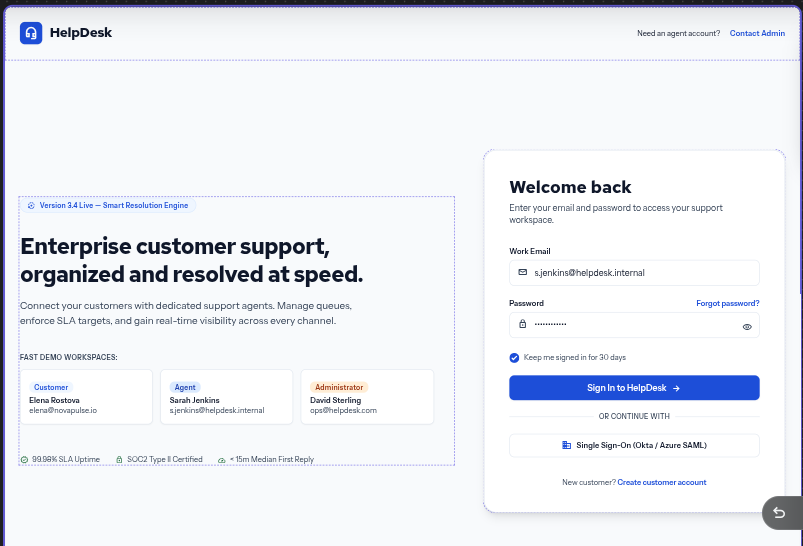
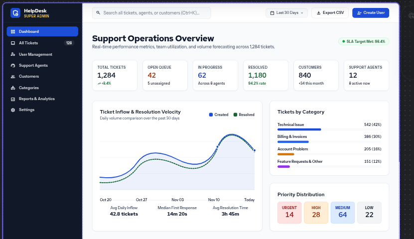
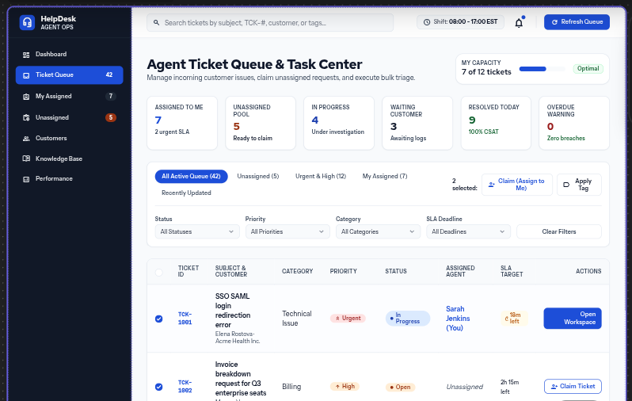
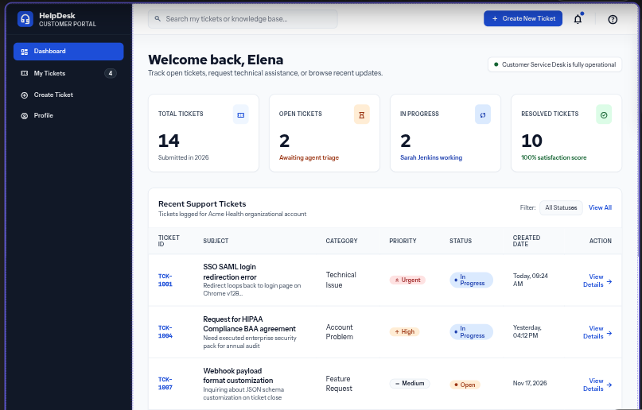

# React + Vite


# Frontend – Ticketing System

## 1. Overview

The frontend is the user interface of the Ticketing System. It allows customers, support agents, and administrators to interact with the application.

## Screenshots

### Login Page


### Admin Dashboard


### Support Agent Dashboard


### Customer Dashboard



### Technologies

- **React.js** – Build the user interface.
- **JavaScript (JSX)** – Application logic and components.
- **Tailwind CSS** – Styling.
- **React Router** – Navigation between pages.
- **Axios** – Communication with the FastAPI backend.

---

## 2. Recommended Folder Structure

```text
frontend/
└── src/
    ├── assets/
    │   ├── images/
    │   └── icons/
    │
    ├── components/
    │   ├── common/
    │   │   ├── Button.jsx
    │   │   ├── Input.jsx
    │   │   └── Modal.jsx
    │   │
    │   ├── layout/
    │   │   ├── Sidebar.jsx
    │   │   └── Navbar.jsx
    │   │
    │   └── tickets/
    │       ├── TicketTable.jsx
    │       ├── TicketStatus.jsx
    │       └── TicketPriority.jsx
    │
    ├── pages/
    │   ├── auth/
    │   │   ├── Login.jsx
    │   │   └── Register.jsx
    │   │
    │   ├── customer/
    │   │   ├── Dashboard.jsx
    │   │   ├── MyTickets.jsx
    │   │   ├── CreateTicket.jsx
    │   │   └── TicketDetails.jsx
    │   │
    │   ├── agent/
    │   │   ├── Dashboard.jsx
    │   │   ├── AllTickets.jsx
    │   │   ├── AssignedTickets.jsx
    │   │   ├── UnassignedTickets.jsx
    │   │   └── TicketDetails.jsx
    │   │
    │   └── admin/
    │       ├── Dashboard.jsx
    │       ├── Users.jsx
    │       ├── Agents.jsx
    │       ├── Categories.jsx
    │       └── AllTickets.jsx
    │
    ├── services/
    │   ├── api.js
    │   ├── authService.js
    │   ├── ticketService.js
    │   ├── userService.js
    │   └── categoryService.js
    │
    ├── context/
    │   └── AuthContext.jsx
    │
    ├── layouts/
    │   ├── CustomerLayout.jsx
    │   ├── AgentLayout.jsx
    │   └── AdminLayout.jsx
    │
    ├── App.jsx
    ├── main.jsx
    └── index.css
```

---

## 3. Folder Responsibilities

### 3.1 assets/

**Purpose:** Store static files used throughout the application.

```text
assets/
├── images/
└── icons/
```

Examples:

- Company logo.
- User profile images.
- Background images.
- Application icons.

### 3.2 components/

**Purpose:** Store reusable UI components.

Instead of writing the same UI code multiple times, create a component and reuse it wherever needed.

```text
components/
├── common/
├── layout/
└── tickets/
```

**common/**

Contains general-purpose components used across different pages.

| Component | Responsibility |
|---|---|
| Button.jsx | Reusable buttons |
| Input.jsx | Reusable input fields |
| Modal.jsx | Popup windows |

**layout/**

Contains reusable interface elements.

| Component | Responsibility |
|---|---|
| Sidebar.jsx | Navigation sidebar |
| Navbar.jsx | Top navigation bar |

**tickets/**

Contains components specifically related to ticket management.

| Component | Responsibility |
|---|---|
| TicketTable.jsx | Display tickets in a table |
| TicketStatus.jsx | Display ticket status |
| TicketPriority.jsx | Display ticket priority |

### 3.3 pages/

**Purpose:** Store the main pages of the application.

Each page represents a complete screen that users can access through application routes.

```text
pages/
├── auth/
├── customer/
├── agent/
└── admin/
```

**auth/**

Authentication pages.

- `Login.jsx` – User login.
- `Register.jsx` – User registration.

**customer/**

Pages accessible to customers.

- `Dashboard.jsx` – Customer overview.
- `MyTickets.jsx` – Display customer's tickets.
- `CreateTicket.jsx` – Submit a new support ticket.
- `TicketDetails.jsx` – View ticket information and conversation.

**agent/**

Pages accessible to support agents.

- `Dashboard.jsx` – Agent overview.
- `AllTickets.jsx` – View all tickets.
- `AssignedTickets.jsx` – View assigned tickets.
- `UnassignedTickets.jsx` – View tickets waiting for assignment.
- `TicketDetails.jsx` – Manage tickets and communicate with customers.

**admin/**

Pages accessible to administrators.

- `Dashboard.jsx` – System statistics and overview.
- `Users.jsx` – Manage users.
- `Agents.jsx` – Manage support agents.
- `Categories.jsx` – Manage ticket categories.
- `AllTickets.jsx` – Manage all system tickets.

### 3.4 services/

**Purpose:** Handle communication between the React frontend and FastAPI backend.

Keep API requests outside your page components to make the code easier to maintain and reuse.

```text
services/
├── api.js
├── authService.js
├── ticketService.js
├── userService.js
└── categoryService.js
```

| File | Responsibility |
|---|---|
| api.js | Configure Axios and the backend API URL |
| authService.js | Login, register, logout |
| ticketService.js | Create, retrieve, update tickets |
| userService.js | Retrieve and manage users |
| categoryService.js | Retrieve and manage ticket categories |

**Example: api.js**

```javascript
import axios from "axios";

const api = axios.create({
  baseURL: "http://localhost:8000/api",
  headers: {
    "Content-Type": "application/json",
  },
});

export default api;
```

**Example: ticketService.js**

```javascript
import api from "./api";

export const getTickets = async () => {
  const response = await api.get("/tickets/");
  return response.data;
};

export const createTicket = async (ticketData) => {
  const response = await api.post("/tickets/", ticketData);
  return response.data;
};
```

### 3.5 context/

**Purpose:** Share application state between multiple components without passing props through every component.

For this project, React Context API manages authentication information.

```text
context/
└── AuthContext.jsx
```

**AuthContext.jsx** can manage:

- Logged-in user information.
- Authentication status.
- User role (customer, agent, admin).
- Login and logout functions.

**Example: AuthContext.jsx**

```jsx
import { createContext, useContext, useState } from "react";

const AuthContext = createContext();

export const AuthProvider = ({ children }) => {
  const [user, setUser] = useState(null);

  const login = (userData) => {
    setUser(userData);
  };

  const logout = () => {
    setUser(null);
  };

  return (
    <AuthContext.Provider value={{ user, login, logout }}>
      {children}
    </AuthContext.Provider>
  );
};

export const useAuth = () => useContext(AuthContext);
```

**Why do we need it?**

For example, the Navbar, Sidebar, and protected pages may all need to know which user is logged in.

Instead of passing user information manually between components, they can access it through `AuthContext`.

> Note: React Context manages frontend state. The backend must still enforce authentication and authorization.

### 3.6 layouts/

**Purpose:** Define the common page structure for each user role.

A layout is a wrapper around multiple pages. It allows different pages to share the same navigation and interface structure.

```text
layouts/
├── CustomerLayout.jsx
├── AgentLayout.jsx
└── AdminLayout.jsx
```

| Layout | Responsibility |
|---|---|
| CustomerLayout.jsx | Customer sidebar, navbar and page content |
| AgentLayout.jsx | Agent sidebar, navbar and page content |
| AdminLayout.jsx | Admin sidebar, navbar and page content |

**Example: CustomerLayout.jsx**

```jsx
import { Outlet } from "react-router-dom";
import Sidebar from "../components/layout/Sidebar";
import Navbar from "../components/layout/Navbar";

const CustomerLayout = () => {
  return (
    <div className="flex min-h-screen">
      <Sidebar />

      <div className="flex-1">
        <Navbar />

        <main className="p-6">
          <Outlet />
        </main>
      </div>
    </div>
  );
};

export default CustomerLayout;
```

**How does it work?**

The `Outlet` component from React Router displays the page associated with the current nested route.

For example:

```text
CustomerLayout
    ├── Dashboard
    ├── MyTickets
    ├── CreateTicket
    └── TicketDetails
```

All these pages share the same CustomerLayout without repeating the Navbar and Sidebar code.

---

## 4. Difference Between components/ and layouts/

These two folders have different responsibilities.

| components/ | layouts/ |
|---|---|
| Contains reusable UI elements | Contains complete page structures |
| Button, Input, Modal | CustomerLayout, AgentLayout |
| Used inside pages and layouts | Wraps multiple pages |
| Focuses on individual elements | Focuses on overall page organization |

**Example:**

A Sidebar is a component because it represents one reusable UI element.

A CustomerLayout is a layout because it combines the Sidebar, Navbar, and page content.

---

## 5. Application Entry Points

The following files are located directly inside `src/`.

| File | Responsibility |
|---|---|
| App.jsx | Defines application routes |
| main.jsx | Entry point that renders the React application |
| index.css | Global styles and Tailwind CSS imports |

**main.jsx**

Initializes the React application and renders the root component.

**App.jsx**

Defines routes for authentication, customers, agents, and administrators using React Router.

**index.css**

Contains global CSS rules and Tailwind CSS imports.

---

## 6. Application Architecture

The frontend communicates with the backend using the following architecture:

```text
                 React Application
                        |
                        v
                  React Router
                        |
          +-------------+-------------+
          |             |             |
        Pages        Layouts       Context
          |             |             |
          +-------------+-------------+
                        |
                        v
                    Services
                        |
                        v
                      Axios
                        |
                        v
                 FastAPI Backend
                        |
                        v
                    PostgreSQL
```

**Request example:**

1. The customer opens the My Tickets page.
2. `MyTickets.jsx` calls `getTickets()` from `ticketService.js`.
3. `ticketService.js` sends an HTTP request through Axios.
4. FastAPI processes the request.
5. FastAPI retrieves tickets from PostgreSQL.
6. The backend returns JSON data.
7. React displays the tickets.

---

## 7. Installation and Setup

### Prerequisites

- Node.js
- npm
- FastAPI backend running

### Install dependencies

```bash
cd frontend
npm install
```

### Install project packages

```bash
npm install axios react-router-dom
```

Install and configure Tailwind CSS according to the version used by the project.

### Start development server

```bash
npm run dev
```

The frontend will usually be available at:

```text
http://localhost:5173
```

---

## 8. Development Guidelines

Follow these guidelines when developing the frontend:

1. Use reusable components whenever possible.
2. Keep pages separate according to user roles.
3. Keep API requests inside the `services/` folder.
4. Use Context API for shared authentication state.
5. Use layouts to avoid repeating navigation structures.
6. Keep component names in PascalCase.
7. Keep service filenames consistent.
8. Use React Router for navigation.
9. Handle API errors and loading states.
10. Enforce authentication and authorization on the backend.

---

## 9. Summary

| Folder | Responsibility |
|---|---|
| `assets/` | Images, logos and icons |
| `components/` | Reusable UI components |
| `pages/` | Application pages |
| `services/` | API communication with FastAPI |
| `context/` | Shared application state |
| `layouts/` | Shared page structures |

**Main idea:**

- `components/` = Reusable UI elements.
- `pages/` = Complete application screens.
- `services/` = Backend API communication.
- `context/` = Shared application state.
- `layouts/` = Common structure for multiple pages.
- `assets/` = Static resources.

This structure keeps the frontend organized, maintainable, and easy to extend as the Ticketing System grows.
